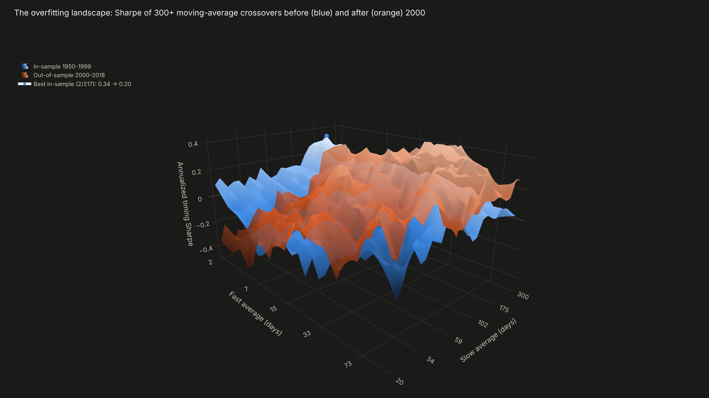
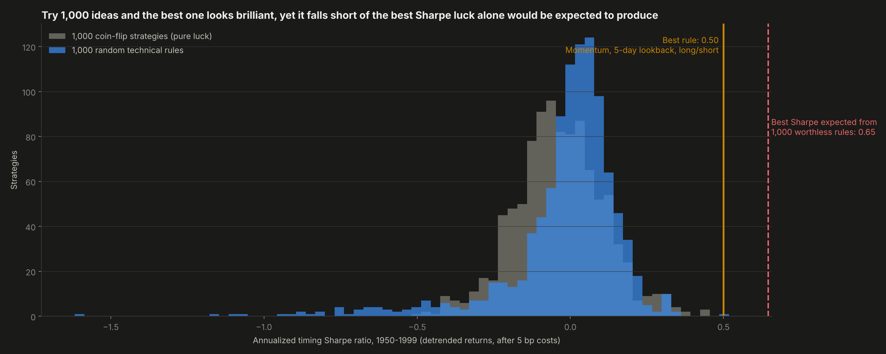
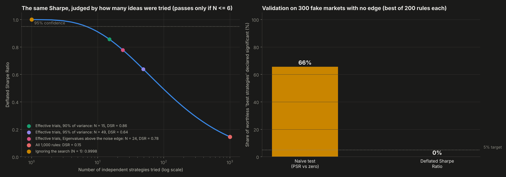
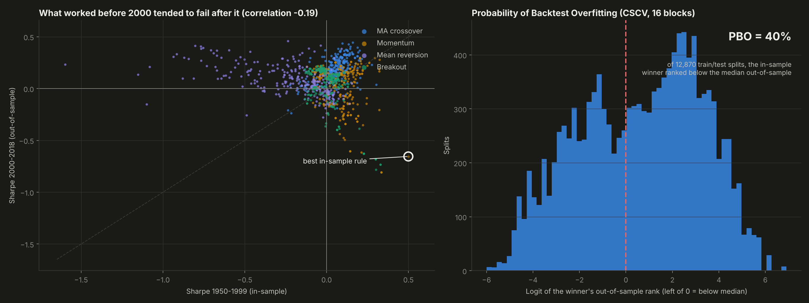
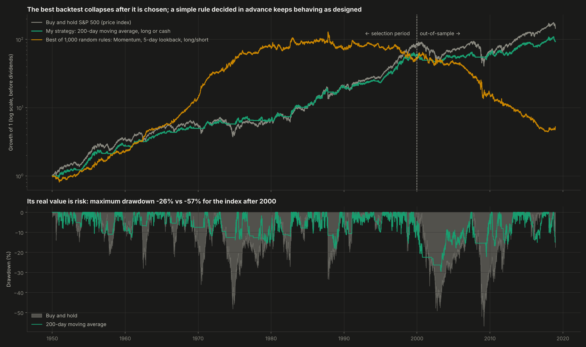

# Backtest Overfitting Detector

Is the Sharpe ratio of my best trading strategy real, or the luck of trying a thousand ideas? 1,000 random technical rules are backtested on 69 years of the S&P 500, and the winner is judged with the Deflated Sharpe Ratio (Bailey and López de Prado, 2014) and the Probability of Backtest Overfitting (Bailey et al., 2017).


**Result:** the best of 1,000 rules in 1950-1999 is a 5-day momentum strategy. It earned a timing Sharpe of **0.50**, and a naive test gives a **99.98%** probability that it is real. But the best Sharpe that 1,000 worthless rules would be expected to reach is **0.65**, so its **Deflated Sharpe Ratio is only 0.15**. After 2000 the same rule earned **-0.65** and ranked in the **bottom 1%** of all 1,000. The Deflated Sharpe Ratio was right; the naive test was not.



---

## Why this project

Backtests are the main evidence behind any trading strategy, and they are easy to fool. Try enough variations (parameters, indicators, time windows) and one of them will look excellent by chance. The Sharpe ratio of that winner is biased upward by the search itself, and the usual significance test ignores the search entirely. This is one of the main reasons so many published and commercial strategies fail with real money. This project measures that bias on real data and applies the two tools built to correct it.

## Objectives

1. Run a realistic strategy search: 1,000 technical rules with transaction costs and no look-ahead.
2. Compare the winner against what pure luck produces.
3. Compute the Probabilistic and Deflated Sharpe Ratios and the effective number of independent trials.
4. Estimate the Probability of Backtest Overfitting with combinatorially symmetric cross-validation.
5. Prove the method works on simulated markets with no edge.
6. Test a simple strategy of my own, chosen before looking at the results.

## Data

**S&P 500 price index, daily close, January 1950 to December 2018** (17,356 days), from a public archive of Yahoo Finance data. Yahoo Finance itself was not reachable from the build environment, which is why the sample ends in 2018. Prices exclude dividends.

- **In-sample (selection):** 1950-1999, 12,581 days.
- **Out-of-sample:** 2000-2018, 4,774 days. This period includes the dot-com crash and the 2008 crisis.

**Detrending.** The S&P 500 rose on average, so any rule that is mostly long earns a positive Sharpe without any timing skill. Following Aronson (2007), the average daily return of each period is removed before testing. Buy-and-hold then has a Sharpe of exactly zero, and whatever Sharpe a rule earns is pure market timing.

## Methodology

**The search** (`src/rules.py`): 1,000 rules with random parameters, 250 from each of four families:

| Family | Rule |
|---|---|
| Moving-average crossover | long when the fast average is above the slow one (2 to 300 days) |
| Time-series momentum | long when the price is above its level L days ago (5 to 300 days) |
| Mean reversion | long when the price is k standard deviations below its average, short or flat when above |
| Breakout | long on a new N-day high, out on a new N/2-day low |

Each rule is randomly long/flat or long/short. Positions are decided at the close and applied to the next day's return, and every change of position costs 5 basis points.

**The statistics** (`src/stats.py`, written from scratch):
- **Probabilistic Sharpe Ratio:** the probability that the true Sharpe exceeds a benchmark. It accounts for sample length, skewness and fat tails.
- **Expected maximum Sharpe under the null (False Strategy Theorem):** the Sharpe the best of N worthless strategies would reach, from the dispersion of the N Sharpe ratios tried.
- **Deflated Sharpe Ratio:** the PSR of the winner measured against that expected maximum instead of against zero.
- **Effective number of trials:** the 1,000 rules are highly correlated, so the number of truly independent ideas is estimated from the eigenvalues of their correlation matrix. Three estimators are used: the components explaining 90% and 95% of the variance, and the eigenvalues above the Marchenko-Pastur noise edge.
- **Probability of Backtest Overfitting (CSCV):** the sample is cut into 16 blocks and all 12,870 ways of choosing 8 as in-sample are evaluated. PBO is the share of splits where the in-sample winner ranks below the median out-of-sample.
- **Minimum track record length:** the years of data needed to be 95% sure.

## Results

**1. The winner looks significant only if the search is ignored**

| | Value |
|---|---|
| Best in-sample rule | 5-day momentum, long/short |
| Annualized timing Sharpe, 1950-1999 | 0.50 |
| Naive probability that the Sharpe is real (PSR vs zero) | 0.9998 |
| Best Sharpe expected from 1,000 worthless rules | 0.65 |
| **Deflated Sharpe Ratio, N = 1,000** | **0.15** |
| DSR with effective trials (N = 15 / 24 / 49) | 0.86 / 0.78 / 0.64 |
| Largest number of trials for which it would pass at 95% | 6 |
| Same rule, 2000-2018 | **-0.65** (bottom 1% of the 1,000 rules) |

Even under the most generous estimate of how many independent ideas were tested, the winner does not clear the 95% bar. It would only pass if fewer than 7 ideas had been tried.

**2. The method works on markets with no edge.** I generated 300 fake 10-year markets (fat-tailed random walks with no predictable pattern) and picked the best of 200 rules in each.
- **The naive test** declared the winner significant in **66%** of them.
- **The Deflated Sharpe Ratio** did so in **0%**. It is conservative here, because the rules are correlated and N overstates the number of independent trials.

**3. Overfitting is systematic, not just one unlucky rule**
- **The ranking does not survive 2000.** The correlation between a rule's Sharpe before 2000 and after it is **-0.19**. Short-term momentum rules (5 to 20 days) had a median Sharpe of 0.17 before 2000 and -0.40 after it, while mean reversion went from -0.15 to 0.06: the daily behavior of the market itself changed.
- **PBO is 40%:** in 40% of the 12,870 train/test splits, the in-sample winner ranked below the median out-of-sample. On average the winner's Sharpe fell from 0.38 in-sample to 0.04 out-of-sample.
- **Diversified selection survives better than the single winner.** The top 10% of rules had a median Sharpe of 0.19 in-sample and still 0.15 after 2000, mostly slow trend-following rules.

**4. My own strategy, chosen in advance:** a 200-day moving average, long or in cash.

| | 1950-1999 | 2000-2018 |
|---|---|---|
| Sharpe (raw returns) | 0.84 vs 0.66 buy-and-hold | 0.20 vs 0.14 buy-and-hold |
| Volatility | 9.8% vs 13.6% | 10.8% vs 19.1% |
| Maximum drawdown | **-18% vs -48%** | **-26% vs -57%** |
| Timing Sharpe (detrended) | 0.20, PSR 0.92 | 0.04, PSR 0.56 |

It is honest to say that its pure timing skill is not statistically proven. Even before 2000, the PSR of 0.92 is below 95%, and proving a timing Sharpe this small would take decades of data. What it does deliver, consistently in both periods, is risk control: similar or better Sharpe than the index with about half the volatility and half the worst loss. That is the realistic claim for trend filters, and the one this project supports.

| | |
|---|---|
|  |  |
|  |  |

**Interactive:** `dashboard.html` includes:
- a **Deflated Sharpe Ratio calculator**: enter the Sharpe, years of data, number of strategies tried, their dispersion, skewness and kurtosis of any backtest, and it returns the DSR, the luck hurdle and the years of data needed;
- the rotatable 3D overfitting landscape of moving-average crossovers before and after 2000.

## Structure

```
backtest-overfitting-detector/
├── main.py               # search, statistics, validation, own strategy, charts, dashboard
├── src/rules.py          # random technical rule generator and backtester (costs, no look-ahead)
├── src/stats.py          # Sharpe, PSR, expected max Sharpe, DSR, effective trials, PBO by CSCV, MinTRL
├── data/sp500_daily.csv  # S&P 500 daily prices, 1950-2018
├── outputs/              # charts and metrics.json
└── dashboard.html
```

## How to run

```bash
pip install -r requirements.txt
python main.py
```

Runs in under a minute.

## Development process and use of AI

I framed the question, chose the out-of-sample split, decided to detrend returns so the test measures timing skill and not the equity premium, and fixed my own strategy before looking at the results. I used AI as a working partner for the hardest parts: implementing the Deflated Sharpe Ratio and CSCV from the original papers, estimating the effective number of trials, and brainstorming the overfitting landscape and the calculator. All numbers come from `outputs/metrics.json`, produced by the code in this repository.

## What this project means for my development

This changed how I read any backtest, mine or someone else's. The first question is now how many things were tried, and only after that how good the result looks. It is also the statistical foundation for the systematic trading projects in my roadmap: every strategy I build from here will report its Deflated Sharpe Ratio and an out-of-sample test, not just a pretty equity curve.

## Next steps

- Walk-forward optimization with costs as part of a full systematic backtest (project 27 in my roadmap).
- Extend the data to the present and add other markets (Colombian equities, bonds, currencies).
- Cluster the strategies (López de Prado's ONC algorithm) for a sharper estimate of the effective number of trials.

---

**Author:** Tomás Alarcón, Systems and Computing Engineering, Universidad de los Andes

**References:**
- Bailey, D. H. and López de Prado, M. (2014). The Deflated Sharpe Ratio: Correcting for Selection Bias, Backtest Overfitting and Non-Normality. *Journal of Portfolio Management*, 40(5).
- Bailey, D. H. and López de Prado, M. (2012). The Sharpe Ratio Efficient Frontier. *Journal of Risk*, 15(2).
- Bailey, D. H., Borwein, J., López de Prado, M. and Zhu, Q. J. (2017). The Probability of Backtest Overfitting. *Journal of Computational Finance*, 20(4).
- Aronson, D. (2007). *Evidence-Based Technical Analysis*. Wiley.

**Data:** S&P 500 daily prices from the public archive github.com/vijinho/sp500 (Yahoo Finance data).
